# Facial Emotion Recognition — Comparing 3 Transfer-Learning Strategies (FER2013)

**Final Project — Computer Vision Systems Development (تطوير أنظمة الرؤية الحاسوبية) · SDAIA Academy**

**Student:** Amani Eid Alanazi — أماني عيد العنزي

A computer-vision system that recognises **7 facial emotions** from a face image. One pretrained CNN (**EfficientNet-B0**) is adapted to the FER2013 dataset in **three different ways**, and the three models are compared on **accuracy, loss and training time**. The best model is exported to **ONNX**, optimized (FP16 / INT8), and deployed in a **face-detection + emotion web app** and a **real-time webcam stream**.

🌐 **Try it in your browser:** https://amanialanazi.github.io/FER2013-Emotion-Recognition/ — upload any photo or use the live camera (the model runs on your device, nothing is uploaded).

| Strategy | Test accuracy | Test loss | Macro-F1 | Training time |
|---|---|---|---|---|
| 1. Feature Extraction (last layer only) | 43.52 % | 1.493 | 38.49 % | 15.7 min |
| 2. Partial Fine-Tuning (last 2 blocks) | 54.64 % | 1.192 | 50.32 % | 15.4 min |
| **3. Full Fine-Tuning (whole network)** 🏆 | **67.75 %** | **0.919** | **66.67 %** | 18.4 min |

> Human accuracy on FER2013 is estimated at **≈ 65 %**.

---

## 1. Project Overview
- **Task:** image **classification** (multi-class, 7 classes).
- **Model:** EfficientNet-B0 pretrained on ImageNet, trained with 3 transfer-learning strategies.
- **Output:** the predicted emotion + a confidence score for each of the 7 emotions.
- **Deliverables:** full Colab notebook, trained models (PyTorch + ONNX FP32/FP16/INT8), result tables and figures, a command-line prediction script, a Gradio web demo and a **live webcam stream**.

## 2. Problem Description
Recognising the emotion on a face from a single image. Such a system can support:
- **e-learning platforms** — noticing confused or bored students,
- **customer-experience analysis**,
- **driver monitoring** and **human–robot interaction**.

The task is hard: images are small (48×48) and grayscale, some emotions look alike (fear ↔ surprise, sad ↔ neutral), the classes are imbalanced and some labels are noisy.

**Research question:** *when we reuse a pretrained CNN, how much of it should be re-trained?* Only the last layer, the last few blocks, or the whole network?

## 3. Dataset & Model

### Dataset — [FER2013 (Kaggle)](https://www.kaggle.com/datasets/msambare/fer2013)
| Property | Value |
|---|---|
| Images | 35,887 faces, 48×48, grayscale |
| Classes | angry, disgust, fear, happy, neutral, sad, surprise |
| Split used | **Train 24,402** · **Validation 4,307** (15 % of train, stratified) · **Test 7,178** (official test set, used only for the final evaluation) |
| Imbalance | `happy` 7,215 train images vs. `disgust` only 436 |

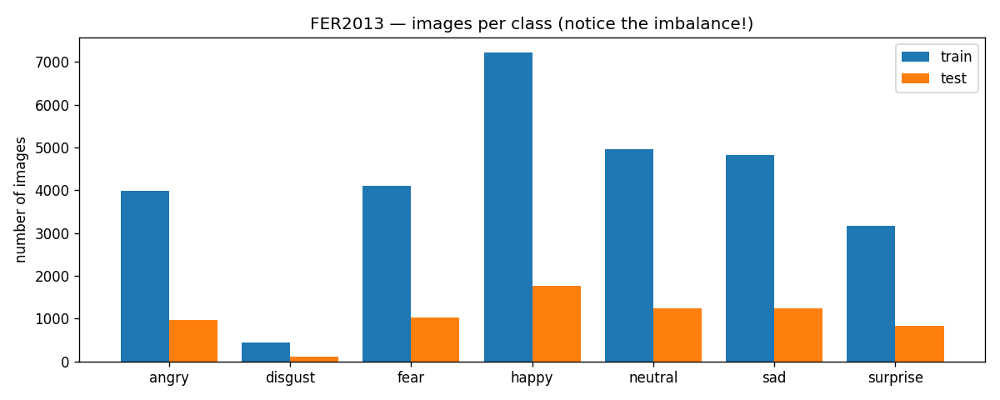

**Preprocessing (all images):** grayscale → 3 channels (the pretrained model expects RGB), resize 48 → 224, ImageNet mean/std normalization.
**Augmentation (training only):** random horizontal flip, small rotation (±10°) / shift / zoom, brightness & contrast jitter.
**Class imbalance:** class-weighted cross-entropy (weights = √(max count / class count), e.g. `disgust` ≈ 2.4, `happy` ≈ 0.6).

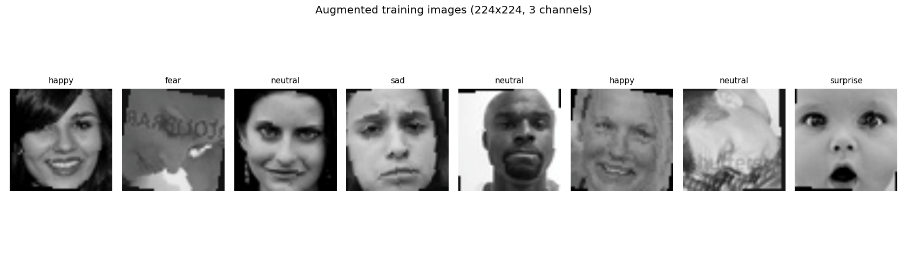

### Model — EfficientNet-B0 (ImageNet)
A modern, efficient CNN (~4 M parameters) built from MBConv blocks. Its last layer (1000 ImageNet classes) is replaced with a new `Linear(1280 → 7)` layer.

| Strategy | Frozen | Trainable | Trainable params |
|---|---|---|---|
| 1. Feature Extraction | all feature blocks | new last layer only | 8,967 (0.2 %) |
| 2. Partial Fine-Tuning | blocks 0–6 | **last 2 blocks** (`features[7:]`) + last layer | 1,138,359 (28.3 %) |
| 3. Full Fine-Tuning | nothing | whole network | 4,016,515 (100 %) |

**Fair comparison:** all three strategies use the same data split, preprocessing, augmentation, loss, optimizer and number of epochs — only the trainable part changes.

| Setting | Value |
|---|---|
| Optimizer | AdamW (weight decay 1e-4), cosine learning-rate schedule |
| Learning rate | 1e-3 for the new layer · 1e-4 for unfrozen pretrained layers |
| Epochs / batch size | 10 / 64 |
| Model selection | weights of the epoch with the best **validation** accuracy |
| Hardware | Google Colab, Tesla T4 GPU, mixed precision (AMP) |

## 4. Workflow / Architecture
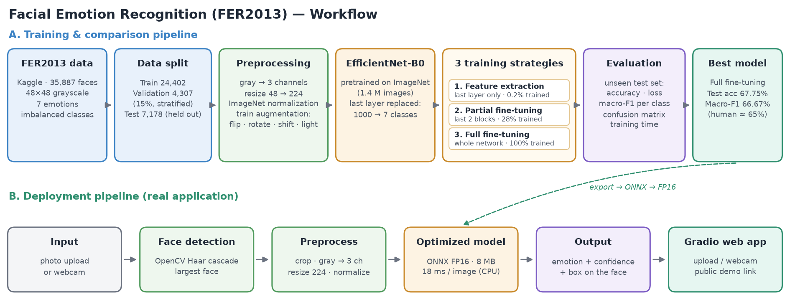

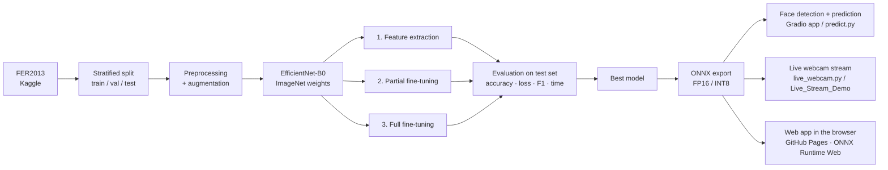

## 5. Results & Evaluation

### Comparison of the 3 strategies (test set, 7,178 images)
| Strategy | Trainable params | Train time | Sec / epoch | Best epoch | Val acc | **Test acc** | Test loss | Macro-F1 | Weighted-F1 |
|---|---|---|---|---|---|---|---|---|---|
| 1. Feature Extraction | 8,967 (0.2 %) | 15.7 min | 94 | 9 | 43.35 % | 43.52 % | 1.493 | 38.49 % | 42.09 % |
| 2. Partial Fine-Tuning | 1,138,359 (28.3 %) | 15.4 min | 92 | 8 | 55.82 % | 54.64 % | 1.192 | 50.32 % | 54.12 % |
| 3. Full Fine-Tuning | 4,016,515 (100 %) | 18.4 min | 110 | 8 | 68.35 % | **67.75 %** | **0.919** | **66.67 %** | **67.52 %** |

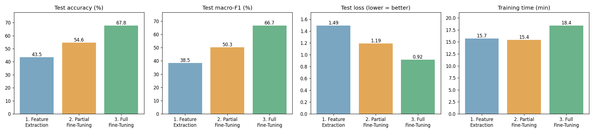
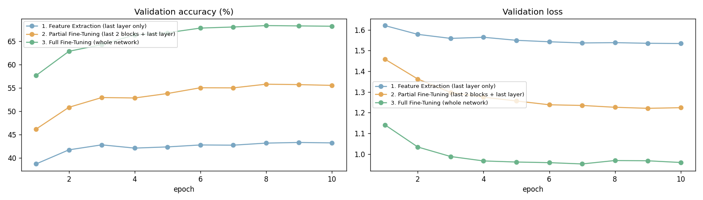

**Findings**
- **The more of the network we fine-tune, the better the result**: 43.5 % → 54.6 % → 67.8 %. ImageNet features were learned on objects (cars, animals…), not facial expressions, so they must be adapted to faces.
- **Training time was almost the same** (15–18 min) even though strategy 3 trains ~450× more parameters than strategy 1. The bottleneck was the **data pipeline on the CPU** (loading, augmenting and resizing images), not the GPU.
- **Overfitting:** strategies 1 and 2 show none (validation ≥ training accuracy, because training images are augmented and dropout is active only during training). Strategy 3 starts to overfit after epoch ~5 (by epoch 10: train 74.5 % vs. val 68.2 %; validation loss stops improving); keeping the **best validation epoch** (epoch 8) protects the final model.
- Validation and test accuracy are very close (68.35 % vs. 67.75 %) → the model generalises to unseen data.

### Per-class results
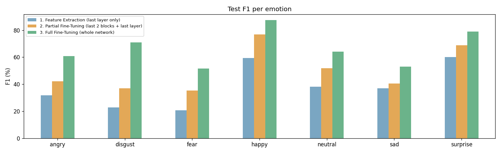

Best model (Full Fine-Tuning) — classification report:

| Emotion | Precision | Recall | F1 | Test images |
|---|---|---|---|---|
| angry | 0.585 | 0.630 | 0.607 | 958 |
| disgust | 0.716 | 0.703 | 0.709 | 111 |
| fear | 0.542 | 0.490 | 0.515 | 1,024 |
| happy | 0.879 | 0.868 | **0.874** | 1,774 |
| neutral | 0.597 | 0.692 | 0.641 | 1,233 |
| sad | 0.582 | 0.489 | 0.531 | 1,247 |
| surprise | 0.768 | 0.813 | 0.790 | 831 |

- **Easiest:** `happy` (F1 0.87) and `surprise` (0.79) — very distinctive expressions (smile, open mouth).
- **Hardest:** `fear` (0.52) and `sad` (0.53) — subtle and similar to other emotions.
- `disgust` reaches F1 0.71 despite having only 436 training images — the class-weighted loss works.

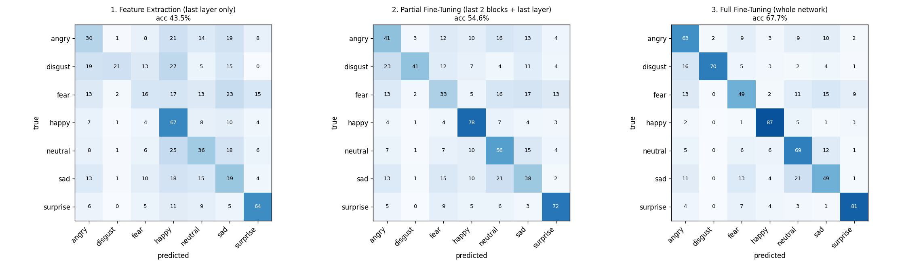

Most frequent confusions of the best model: **sad → neutral** (260), sad → fear (166), fear → sad (156), neutral → sad (147), sad → angry (139).

### Successful predictions and failure cases
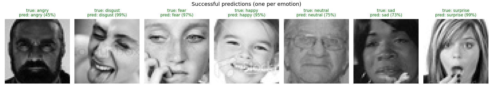
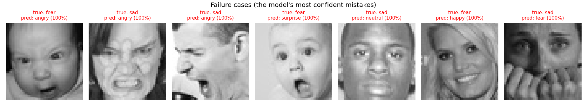

**Why does the model fail?** Several of its most confident "mistakes" look like **labeling errors** in the dataset (e.g. faces labeled *sad* that appear to show anger). Other failures come from very similar expressions (fear vs. surprise, sad vs. neutral), hands covering the face, side poses and the low 48×48 resolution.

### Full prediction pipeline on test images (face detection → emotion + confidence)
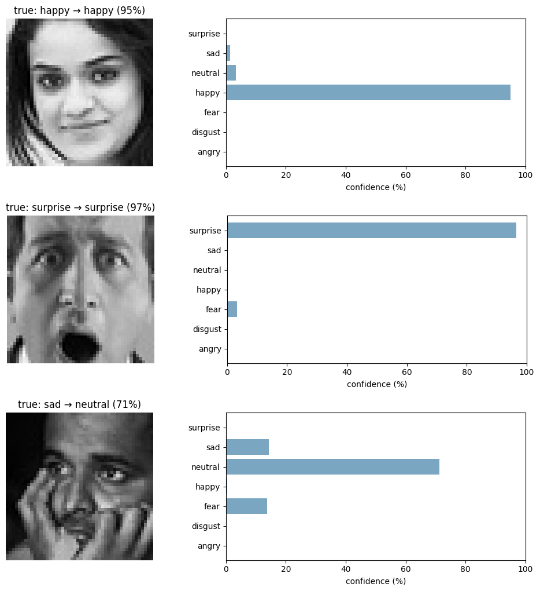

## 6. Deployment & Optimization
The best model is exported to **ONNX** so it can run without PyTorch (servers, web, mobile, edge devices) with **ONNX Runtime**, and then optimized. Measured on CPU (Colab) on 1,000 test images:

| Model | File size | Accuracy | Latency (CPU, 1 image) |
|---|---|---|---|
| PyTorch FP32 | 16.3 MB | 66.7 % | 95.1 ms |
| ONNX FP32 | 16.1 MB | 66.7 % | 24.1 ms |
| **ONNX FP16** ✅ deployed | **8.1 MB** | **66.8 %** | **18.2 ms** |
| ONNX INT8 (static, all layers) | 4.9 MB | 29.9 % ❌ | 21.2 ms |
| ONNX INT8 (depthwise layers kept FP32) | 4.9 MB | 64.3 % | 118.5 ms |

- **ONNX alone made inference ~4× faster** than PyTorch on CPU with identical accuracy.
- **FP16 halves the file size** with no accuracy loss and is the fastest → this is the deployed model.
- **Lesson learned — INT8 quantization:** naive static INT8 quantization destroyed accuracy (66.7 % → 29.9 %). EfficientNet's **depthwise convolutions** (one filter per channel) are very sensitive to 8-bit rounding. Keeping them in FP32 recovers most of the accuracy (64.3 %), but it is slow on CPU. Proper INT8 would need quantization-aware training (QAT).

### Web app (GitHub Pages) — upload a photo or use the live camera
**https://amanialanazi.github.io/FER2013-Emotion-Recognition/** (`index.html`)
- The deployed **ONNX FP16** model runs **inside the browser** with ONNX Runtime Web (WebAssembly) — no server, no install, works on laptops and phones, and the photo never leaves the device.
- Faces are found with the same OpenCV Haar cascade (OpenCV.js), cropped and preprocessed exactly like the test images, then each face gets its emotion + the 7 probabilities.
- **Live camera** mode runs the same pipeline on every video frame (≈ 6–10 FPS on a laptop CPU).

### Live stream (real-time webcam)
The best model also runs on a **live video stream**: every frame → face detection → ONNX FP16 model → emotion + confidence drawn on the video.
- **On a laptop:** `python live_webcam.py` (opens the webcam, press `q` to quit) — runs on the CPU in real time.
- **In Google Colab:** open [`Live_Stream_Demo.ipynb`](https://colab.research.google.com/github/amanialanazi/FER2013-Emotion-Recognition/blob/main/Live_Stream_Demo.ipynb) → `Run all` → open the public Gradio link → allow the camera → **Record**. No training needed: it downloads the FP16 model from this repository.

**Real application:** a **Gradio** web app (in the notebook) — upload a photo or use the webcam → OpenCV detects the face → the face is cropped and preprocessed → the ONNX model predicts the emotion → the app shows the top-3 emotions and draws a box on the face. The same pipeline is available as a script: `predict.py`.

## 7. Technologies Used
Python · PyTorch · torchvision · ONNX Runtime Web · OpenCV.js · GitHub Pages · (EfficientNet-B0) · scikit-learn · NumPy · pandas · Matplotlib · OpenCV · ONNX · ONNX Runtime (quantization) · onnxconverter-common (FP16) · Gradio · kagglehub · Google Colab (Tesla T4 GPU)

## 8. How to Run the Project

**Option A — Reproduce everything (Google Colab)**
1. Open `FER2013_Transfer_Learning_Comparison.ipynb` in Google Colab.
2. `Runtime → Change runtime type → T4 GPU`.
3. `Runtime → Run all`. The dataset is downloaded automatically with `kagglehub`. Training the 3 strategies takes about 50 minutes on a T4.
4. The last cell downloads `fer_project_outputs.zip` (models, figures, result tables).

**Option B — Predict with the trained model (any computer, CPU only)**
```bash
git clone https://github.com/amanialanazi/FER2013-Emotion-Recognition.git
cd FER2013-Emotion-Recognition
pip install onnxruntime "opencv-python-headless<5" pillow numpy
python predict.py path/to/photo.jpg --save result.jpg
```
Example output: `Face 1: happy 96.8% | neutral 2.4% | sad 0.6%`

**Option C — Live webcam stream**
```bash
pip install onnxruntime "opencv-python<5" numpy
python live_webcam.py            # press q to quit
```
Or in Colab: [Live_Stream_Demo.ipynb](https://colab.research.google.com/github/amanialanazi/FER2013-Emotion-Recognition/blob/main/Live_Stream_Demo.ipynb) → Run all → open the public link.

### Repository structure
```
├── FER2013_Transfer_Learning_Comparison.ipynb   # full project notebook (with outputs)
├── index.html                                   # web app (GitHub Pages): upload a photo or live camera
├── assets/haarcascade_frontalface_default.xml   # OpenCV face detector used by the web app
├── Live_Stream_Demo.ipynb                       # live webcam stream in Colab (Gradio)
├── live_webcam.py                               # live webcam stream on a laptop (OpenCV)
├── predict.py                                   # command-line prediction (face detection + ONNX)
├── requirements.txt
├── models/
│   ├── best_model.pth                           # PyTorch weights (Full Fine-Tuning)
│   ├── fer_efficientnet_b0_fp16.onnx            # deployed model (8 MB)
│   ├── fer_efficientnet_b0_fp32.onnx
│   ├── fer_efficientnet_b0_int8.onnx            # failed static INT8 (kept for the comparison)
│   ├── fer_efficientnet_b0_int8_partial.onnx
│   └── *_history.json                           # loss/accuracy per epoch for each strategy
├── results/                                     # comparison.csv, per_class_f1.csv, optimization.csv, report
└── figures/                                     # all plots used in this README
```

## 9. Future Improvements
1. **Better labels:** train with the cleaned **FER+** labels; many errors are labeling noise.
2. **More data for rare classes** (`disgust`, `fear`) or oversampling.
3. **Face alignment** (rotate/crop faces using eye landmarks) before classification.
4. **Stronger regularisation / augmentation:** label smoothing, Random Erasing, MixUp/CutMix — strategy 3 started to overfit after epoch ~5.
5. **Gradual unfreezing** and learning-rate tuning; more epochs with early stopping.
6. **Bigger or face-specific backbones** (EfficientNet-B2, ConvNeXt, ViT, models pretrained on face datasets).
7. **Test-time augmentation** and **ensembles** of models.
8. **Quantization-aware training (QAT)** to get an accurate INT8 model for mobile devices; faster data pipeline (GPU augmentation) to cut training time.

## 10. SDAIA Academy GitHub Repository Link
- SDAIA Academy: https://github.com/SDAIAAcademy
- This project: https://github.com/amanialanazi/FER2013-Emotion-Recognition

---
*Dataset: FER2013 (Goodfellow et al., ICML 2013 Workshop "Challenges in Representation Learning"). Pretrained weights: torchvision EfficientNet-B0 (ImageNet).*
